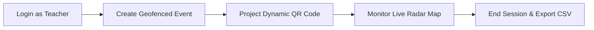
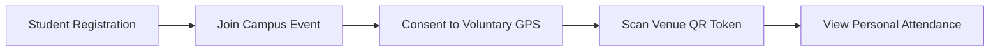

# CLIDGE: Smart Student Location Tracking & Campus Attendance Platform

[](https://clidge.vercel.app)
[](https://react.dev)
[](https://vitejs.dev)
[](https://python.org)
[](https://flask.palletsprojects.com)
[-brightgreen?style=flat)]()
[]()

> **Live Production Website:** [https://clidge.vercel.app](https://clidge.vercel.app)  
> **Status:** Production-Grade & Portfolio-Ready | **Architecture:** Multi-Tenant Universal Campus System

---

## 🏛️ Executive Summary

**CLIDGE** is a full-stack, enterprise-grade campus event tracking and attendance platform built for modern colleges and universities. It replaces legacy manual roll calls and static paper registers with:
- **Hall-Level GNSS Geofencing:** Real-time perimeter monitoring (±4.2m precision) mapped to academic auditoriums, seminar halls, and laboratories.
- **Dynamic Expiring QR Attendance:** High-contrast 2D QR codes with countdown expiry, preventing proxy scanning and off-campus distribution.
- **Voluntary Privacy by Design:** GPS tracking is 100% voluntary, strictly bound to active session hours, and automatically terminated upon session conclusion.
- **Audit-Compliant Reporting:** Instant one-click CSV export containing server-authoritative UTC timestamps, student roll numbers, and physical boundary verification flags.
- **Offline-First Resiliency:** Browser IndexedDB queues attendance transactions during campus network drops and synchronizes idempotently upon reconnection without duplicates.

---

## 👥 Demo Accounts for Review & Viva Evaluation

To test all roles without needing initial registration, use the pre-configured credentials below:

| Role | Name & Designation | Portal | Login Email | Password |
|:---|:---|:---|:---|:---|
| **👩‍🏫 Faculty Coordinator** | Prof. Indrapriyadharshini *(Asst. Prof / CSE)* | **Faculty Portal** | `indrapriyadharshini@clidge.edu.in` | `Teacher@123` |
| **🏛️ Head of Dept (HOD)** | Dr. G. Kavita, Ph.D. *(Professor & HOD / CSE)* | **Faculty Portal** | `kavita.hod@clidge.edu.in` | `Teacher@123` |
| **🎓 Student** | Lakshmanaraja Ramaraj *(III Year / B.E. CSE)* | **Student Portal** | `lakshmanaraja@clidge.edu.in` | `Student@123` |

> **Administrative Provisioning Secret:** `CLIDGE-ADMIN-SECURE-2026`  
> *(Used in the Admin Provisioning modal on the login page to provision new verified faculty coordinator accounts).*

---

## 🛠️ Technology Architecture

```
                    ┌─────────────────────────────────────────┐
                    │          CLIDGE React 18 SPA            │
                    │   Vite 6 • Tailwind CSS • Leaflet.js    │
                    └────────────────────┬────────────────────┘
                                         │
                 ┌───────────────────────┴───────────────────────┐
                 │                                               │
                 ▼                                               ▼
┌─────────────────────────────────┐             ┌─────────────────────────────────┐
│     Cloud Backend Gateway       │             │   Firebase / Firestore Layer    │
│   Python 3.11 • Flask REST API  │             │   Authentication • ID Tokens    │
│   Haversine Geofencing Engine   │             │   Cloud Firestore Collections   │
└────────────────┬────────────────┘             └────────────────┬────────────────┘
                 │                                               │
                 └───────────────────────┬───────────────────────┘
                                         │
                                         ▼
                        ┌─────────────────────────────────┐
                        │      Client IndexedDB Cache     │
                        │    Offline-First Buffer Store   │
                        │    Idempotent Deduplication     │
                        └─────────────────────────────────┘
```

| Layer | Technologies | Deployment Target |
|:---|:---|:---|
| **Frontend Client** | React 18, Vite 6, Tailwind CSS, Lucide Icons, Leaflet / OpenStreetMap | **Vercel** (`https://clidge.vercel.app`) |
| **Backend REST API** | Python 3.11, Flask 3.0, Gunicorn, Geodesic Distance Engine | **Render** (`render.yaml`) |
| **Data & Auth Layer** | Google Cloud Firebase Auth (Email/Password), Cloud Firestore | **Google Cloud Platform** |
| **Offline Cache** | Browser IndexedDB (`clidge_campus_offline_db_v1`) | Client Local Storage |

---

## 🔄 User Workflows

### Faculty Coordinator Workflow

1. **Login:** Faculty signs in through the Faculty Portal.
2. **Publish Event:** Coordinator enters event title, venue, coordinates, geofence radius (e.g. 65m), capacity, and schedule.
3. **Project QR:** Coordinator displays the rotating, time-bounded 2D QR token on the hall projector.
4. **Live Radar:** Faculty inspects the Leaflet map showing participating student markers with real-time status (`Inside Venue`, `Outside Bounds`, `Outdated`).
5. **Report Export:** At session conclusion, clicking "End Event" automatically terminates student tracking and generates a verified attendance CSV file.

### Student Attendee Workflow

1. **Access:** Student signs in or registers via `/register`.
2. **Join Event:** Student browses upcoming events, clicks "Join", and accepts voluntary location sharing.
3. **Verify Presence:** Student's mobile device checks physical proximity against the hall perimeter.
4. **Scan QR:** Student scans the projected QR code to record server-authoritative check-in/out timestamps.
5. **Track Attendance:** Student inspects their digital ID card and cumulative semester attendance record.

---

## 💻 Local Quickstart Setup

### Prerequisites
- **Node.js:** v18.0.0 or higher
- **Python:** v3.11.x (for backend)
- **Git**

### 1. Clone the Repository
```bash
git clone https://github.com/iiaammlluucckkyy/clidge.git
cd clidge
```

### 2. Frontend Setup
```bash
# Install dependencies
npm install

# Start Vite development server
npm run dev
```
The frontend is available at `http://localhost:5173`.

### 3. Backend Setup (Optional for Local REST API)
```bash
# Navigate to backend directory
cd backend

# Install Python requirements
pip install -r requirements.txt

# Start Flask development server
python run.py
```
The backend REST API runs at `http://localhost:5000/api` (Health check: `http://localhost:5000/api/health`).

---

## 🧪 Comprehensive Automated Test Suites

CLIDGE includes **125 automated tests** covering end-to-end functionality, security, geofencing, and authentication:

```bash
# Run Frontend Authentication & Security Suite (20 tests)
node testAuth.js

# Run Event Lifecycle & Participation Suite (30 tests)
node scripts/testEventManagement.js

# Run Full 21-Feature Comprehensive Integration Suite (44 tests)
node scripts/testFinalComprehensive.js

# Run Backend Pytest Suite (31 tests)
python -m pytest backend/tests

# Run Production Build Verification
npm run build
```

**Total Verification: 125 Passed, 0 Failed (100% Green)**

---

## 📚 Documentation Directory

Explore dedicated guides in the [`docs/`](docs/) directory:
- 📖 [**Institutional Onboarding Guide**](docs/ONBOARDING_GUIDE.md): Step-by-step rollout for college administrators.
- 🔐 [**Administrator Guide**](docs/ADMIN_GUIDE.md): Faculty provisioning, geofence setup, and event lifecycle rules.
- 🛡️ [**Compliance & Student Privacy Charter**](docs/COMPLIANCE_AND_PRIVACY.md): Data minimization, voluntary GPS, and retention policies.
- 🚀 [**Deployment Pre-Flight Checklist**](docs/DEPLOYMENT_CHECKLIST.md): Production checklist for Vercel, Render, and Firebase.
- 📄 [**API Documentation**](docs/CLIDGE_API_DOCUMENTATION.md): Detailed REST endpoint specifications.

---

## 🏆 Acknowledgements & Pilot Attribution

CLIDGE was conceptualized, prototyped, and validated within the **Department of Computer Science and Engineering** at **Muthayammal Engineering College (Autonomous)**, Rasipuram, Tamil Nadu, India.

- **Developer & Lead Engineer:** Lakshmanaraja Ramaraj
- **Project Coordination:** Prof. Indrapriyadharshini *(Assistant Professor / CSE)*
- **Academic Leadership:** Dr. G. Kavita, Ph.D. *(Professor & Head of Department / CSE)*

---

## 📄 License

This project is licensed under the MIT License — see the [LICENSE](LICENSE) file for details.
