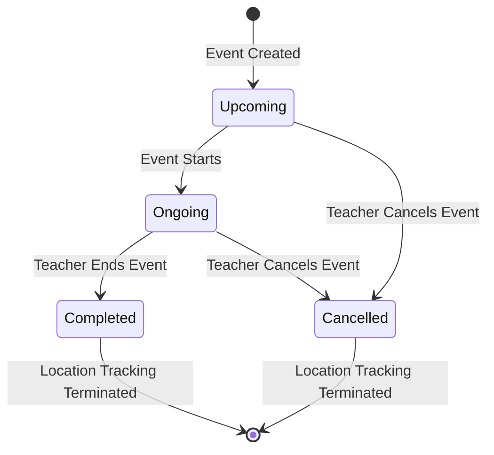

# CLIDGE Administrator & Coordinator Operational Guide

This document defines administrative procedures, security configurations, and event management operations for the **CLIDGE** platform.

---

## 1. Administrative Authorization Secret (`VITE_ADMIN_PROVISION_SECRET`)

To prevent unauthorized users from creating faculty accounts with elevated monitoring privileges, CLIDGE protects teacher creation behind a trusted administrative secret.

- **Default Key:** `CLIDGE-ADMIN-SECURE-2026`
- **Location:** Configured in root `.env` (and Vercel environment variables as `VITE_ADMIN_PROVISION_SECRET`).
- **Best Practice:** Change this value in production before granting portal access to staff.

---

## 2. Provisioning Faculty Coordinator Accounts

1. Navigate to `https://clidge.vercel.app/login?portal=teacher`.
2. Click **"Need to provision a faculty coordinator? Click here"** at the bottom of the card.
3. Fill in the required faculty details:
   - **Faculty Full Name:** e.g., `Prof. Indrapriyadharshini`
   - **Official Email:** `faculty@college.edu.in`
   - **Employee Code / Reg:** `FAC-CSE-015`
   - **Department:** `Computer Science and Engineering`
   - **Designation:** `Assistant Professor & Event Coordinator`
   - **Administrative Secret Key:** `CLIDGE-ADMIN-SECURE-2026`
4. Click **Provision Teacher Account**. The account is instantly authorized and pre-filled into the login form.

---

## 3. Creating & Configuring Geofenced Events

When creating a new academic event or lab session from the Faculty Dashboard:

| Field | Required? | Guideline |
|---|---|---|
| **Event Title** | Yes | Specific, recognizable academic title (e.g. *Generative AI Workshop 2026*). |
| **Description** | Yes | Summary of agenda, topics, or laboratory objectives. |
| **Venue Name** | Yes | Name of hall or laboratory (e.g. *Main Auditorium (Kamarajar Hall)*). |
| **Latitude & Longitude** | Yes | Center coordinates of the physical venue building. |
| **Geofence Radius** | Yes | Perimeter radius in meters (typically 45m – 70m). |
| **Date & Time** | Yes | Date, start time, and end time. |
| **Capacity** | Yes | Max student seating capacity (e.g. 150). |

---

## 4. Event Lifecycle & Automated Termination Rules

- **Upcoming:** Students can voluntarily register; GPS tracking is **idle/dormant**.
- **Ongoing:** Registered students who opted in broadcast GPS coordinates strictly within the venue radius; dynamic QR codes rotate.
- **Completed:** When faculty clicks **End Event**, all participant tracking is **automatically terminated** (`sharingStatus: Ended`).
- **Cancelled:** Immediately marks session cancelled and releases all device GPS permissions.

---

## 5. Attendance Auditing & Official CSV Reports

1. From the Faculty Dashboard or Event Catalog, click **"Attendance Report"** on any session.
2. The modal summarizes:
   - Total enrolled participants
   - Total verified check-ins and check-outs
   - Real-time attendance compliance rate
   - Breakdown of Live GPS, Outdated, and Absent attendees
3. Click **"Download CSV Report"** to export the official audit sheet. The exported file includes student names, roll numbers, departments, exact server UTC check-in/out timestamps, and physical geofence compliance flags.
