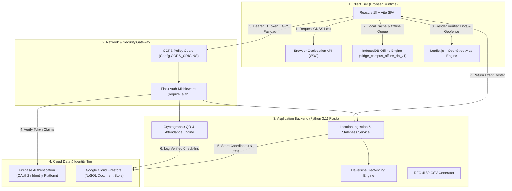
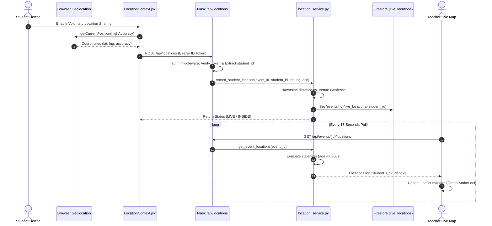
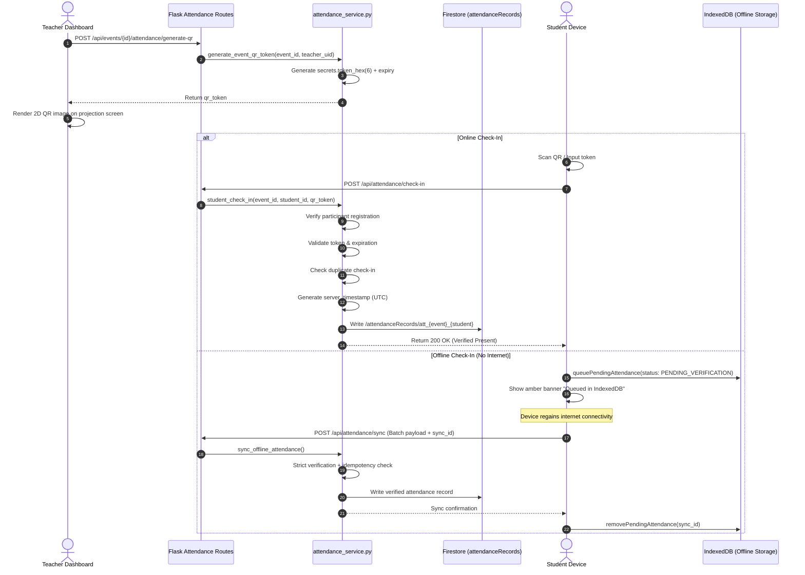

# CLIDGE System Architecture & Technical Design

> **Project Title:** Smart Student Location Tracking & Campus Event Participation Monitoring System  
> **Document Version:** 1.0.0 | **Author:** Senior Software Architect & Full-Stack Engineering Review  
> **Institution:** Department of Computer Science and Engineering, Muthayammal Engineering College (Autonomous), Rasipuram  

---

## 1. High-Level Architectural Pattern

CLIDGE is engineered around a **Tiered Service-Oriented Web Architecture** combined with an **Event-Driven Client Synchronizer**. The application cleanly decouples presentation, geofencing logic, cryptographic verification, and persistent database storage.

---

## 2. Seven-Tier System Decomposition

### Tier 1: Presentation Layer (UI/UX)
- **Role:** Deliver responsive, low-latency, and accessible user interfaces for both students and faculty.
- **Components:**
  - `LandingPage.jsx`: Institutional branding, project context, and viva demonstration quick-switchers.
  - `StudentDashboard.jsx`: Voluntary GPS tracking widget, joined event roster, SVG compliance gauge, and personal history panel.
  - `TeacherDashboard.jsx`: Institutional KPI metric cards, Leaflet OpenStreetMap interactive monitoring view, live student roster table, and live attendance widget.
  - `EventManagementPage.jsx`: Filtered catalog with tabs for All, Created, Upcoming, Joined, and Historical events.
  - `QRScannerModal.jsx`: Dual-mode modal operating as a high-contrast 2D QR projection card for teachers, and an animated laser viewfinder with manual fallback for students.
  - `AttendanceReportModal.jsx`: Multi-metric analytics dialog with compliance progress bars, GNSS distribution charts, filterable attendance tables, and CSV download triggers.

### Tier 2: Frontend State & Context Layer
- **Role:** Maintain reactive synchronization across asynchronous network calls, GPS polling, and hardware events.
- **Modules:**
  - `AuthContext.jsx`: Manages current user profile, active role (`student` vs. `teacher`), session token retrieval, and seamless role-switching.
  - `EventContext.jsx`: Coordinates event creation, editing, status changes, student joining, and participant count updates.
  - `LocationContext.jsx`: Manages voluntary location consent, browser geolocation polling, configurable update intervals (120s), and client-side staleness detection.
  - `AttendanceContext.jsx`: Coordinates cryptographic QR generation, server check-in/out calls, online/offline network listeners, IndexedDB queueing, and notification toasts.

### Tier 3: Location & Geofencing Layer
- **Role:** Convert raw radio signals into authenticated geospatial telemetry and determine mathematical venue containment.
- **Mechanisms:**
  - **W3C Browser Geolocation:** Polled with `enableHighAccuracy: true`, `timeout: 10000`, `maximumAge: 0`.
  - **Haversine Distance Formulation:** Computes great-circle distance between device $(\text{lat}_1, \text{lon}_1)$ and venue center $(\text{lat}_2, \text{lon}_2)$ across spherical radius $R = 6,371,000\text{ m}$.
  - **Containment Boundary:** 
    $$\text{is\_inside} = (\text{distance\_meters} \le \text{radius\_meters})$$

### Tier 4: Client Offline Storage Tier
- **Role:** Guarantee business continuity when Wi-Fi or cellular networks drop.
- **Implementation:**
  - Native `IndexedDB` database: `clidge_campus_offline_db_v1` (Version 1).
  - Object Stores:
    1. `permitted_events`: Locally cached event details.
    2. `pending_attendance`: Queued check-ins/check-outs with `status: "PENDING_VERIFICATION"`.
    3. `cached_attendance_history`: Verified personal participation logs.

### Tier 5: API Gateway & Security Middleware Tier
- **Role:** Terminate incoming HTTP requests, enforce strict CORS policies, and authenticate caller identity.
- **Mechanisms:**
  - `CORS`: Whitelists specific authorized origins (`https://clidge.vercel.app`, `http://localhost:5173`, etc.).
  - `@require_auth`: Flask decorator in `backend/app/utils/auth_middleware.py`. Extracts the Bearer token, invokes `verify_firebase_token()`, and populates `g.user_id` and `g.current_user`. Rejects unauthenticated requests with HTTP 401.

### Tier 6: Core Application Services Tier (Python Flask)
- **Role:** Execute server-side business rules, evaluate staleness, and generate official non-repudiable logs.
- **Services:**
  - `location_service.py`: Enforces student consent, validates coordinate boundaries, computes geofence containment, updates `live_locations`, and evaluates status (`LIVE` vs. `OUTDATED` vs. `UNAVAILABLE`).
  - `attendance_service.py`: Generates cryptographic QR tokens (`secrets.token_hex(6)`), enforces token expiry, prevents duplicate check-ins/check-outs, overrides client timestamps with server UTC time, processes idempotent offline sync batches, and generates RFC 4180 CSV reports.

### Tier 7: Cloud Identity & Persistence Tier
- **Role:** High-availability cloud persistence and secure cryptographic identity verification.
- **Services:**
  - **Firebase Authentication**: Handles credential validation, password hashing, and signed JWT ID tokens.
  - **Google Cloud Firestore**: Scalable NoSQL document store hosting collections for users, events, event participants, live locations, and attendance records.
  - **In-Memory Fallback Engine**: Thread-safe in-memory dictionaries (`_in_memory_events`, `_in_memory_participants`, `_in_memory_locations`, `_in_memory_attendance`) providing instant, self-contained demonstration and test execution capability when cloud credentials are not connected.

---

## 3. Data Flow Diagrams

### Flow A: Multi-Student GPS Telemetry Pipeline

### Flow B: QR Code Attendance Check-In Pipeline

---

## 4. Architectural Decision Records (ADRs)

### ADR-01: Decoupling Attendance Records from GPS Records
- **Context:** An early consideration was storing attendance directly on the live GPS coordinate document.
- **Decision:** Strictly separate GPS positioning (`live_locations`) from Attendance (`attendanceRecords`).
- **Rationale:** 
  1. *Academic Integrity:* GPS proximity proves physical device vicinity, not verified academic participation.
  2. *Data Retention:* Live locations can be pruned or overwritten every update, whereas attendance records must remain permanent, immutable audit logs.
  3. *Privacy:* Separating the stores enables strict access control where students only see their own attendance logs while faculty view event-wide compliance.

### ADR-02: Server-Controlled Non-Repudiation for Timestamps
- **Context:** Mobile clients might submit device clock timestamps that are skewed, manipulated, or incorrect.
- **Decision:** The server discards all client-submitted timestamps for official check-in and check-out records and generates timestamps using `datetime.datetime.now(datetime.timezone.utc)`.
- **Rationale:** Prevents spoofing of attendance time by students altering their local device clock. Client timestamps from offline scans are retained solely in `offlineQueuedAt` for synchronization audit trails.

### ADR-03: Tri-State Staleness Evaluation for Last Known Location
- **Context:** When a student enters a basement or loses network connectivity, their last coordinate remains on the server.
- **Decision:** Implement a three-state staleness lifecycle (`LIVE`, `OUTDATED`, `UNAVAILABLE`) based on a 300-second threshold.
- **Rationale:** Eliminates the hazardous illusion that an old coordinate represents current student location. Faculty immediately see the amber dot and know the data is historical.
