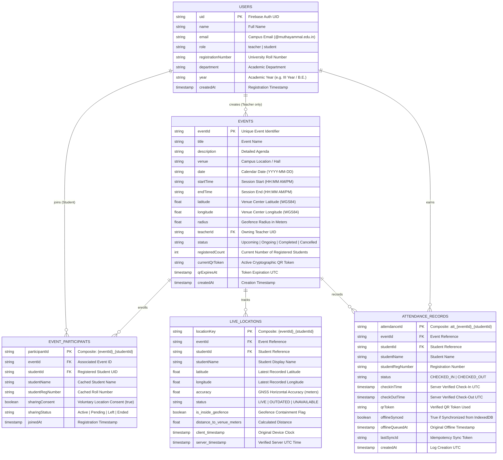

# CLIDGE Database Architecture & Schema Documentation

> **Database System:** Google Cloud Firestore (NoSQL Document Store)  
> **Client Storage:** Browser IndexedDB (`clidge_campus_offline_db_v1`)  
> **Document Version:** 1.0.0  

---

## 1. Database Overview & Design Principles

CLIDGE uses a NoSQL document database model designed for high read scalability, sub-second latency, and document isolation. The database model avoids monolithic nested objects in favor of dedicated collections for users, events, participants, location telemetry, and attendance audit logs.

### Key Database Guarantees
1. **Separation of GPS from Attendance**: Real-time positioning telemetry is kept strictly separate from permanent attendance audit logs.
2. **Document-Level Access Control**: Fine-grained security rules in `firestore.rules` enforce that students can only read and write their own documents.
3. **Dual Persistence Support**: Operates seamlessly against live Google Cloud Firestore, with an identical in-memory fallback engine for local offline execution.

---

## 2. Entity-Relationship (ER) Diagram



---

## 3. Firestore Collection Specifications

### Collection 1: `users`
- **Purpose**: Stores student and faculty identity profiles.
- **Document ID**: Matches the Firebase Authentication `request.auth.uid`.

| Field Name | Type | Constraints | Description |
| :--- | :--- | :--- | :--- |
| `uid` | String | Required, Primary Key | Unique Firebase Authentication user identifier |
| `name` | String | Required | Full name of the student or faculty member |
| `email` | String | Required, Unique | Institutional email (`@muthayammal.edu.in`) |
| `role` | String | Required | Role assignment: strictly `student` or `teacher` |
| `registrationNumber` | String | Optional for Faculty | University roll number (e.g. `731622CSR045`) |
| `department` | String | Required | Department (e.g. `Computer Science and Engineering`) |
| `year` | String | Required for Students | Class year (e.g. `III Year / B.E.`) |
| `designation` | String | Required for Faculty | Designation (e.g. `Associate Professor`) |
| `createdAt` | Timestamp | Required | Timestamp of account registration |

---

### Collection 2: `events`
- **Purpose**: Central catalog of campus events, symposiums, and workshops.
- **Document ID**: Unique event string (e.g., `evt-2026-001`).

| Field Name | Type | Constraints | Description |
| :--- | :--- | :--- | :--- |
| `eventId` / `id` | String | Required, Primary Key | Unique event ID |
| `title` | String | Required | Event title |
| `description` | String | Required | Agenda and topic details |
| `venue` | String | Required | Campus venue (e.g. `Main Auditorium - Kamarajar Hall`) |
| `date` | String | Required | Scheduled date (YYYY-MM-DD) |
| `startTime` | String | Required | Session start time (e.g. `09:30 AM`) |
| `endTime` | String | Required | Session end time (e.g. `04:30 PM`) |
| `latitude` | Float | Required | Venue center point latitude (WGS84) |
| `longitude` | Float | Required | Venue center point longitude (WGS84) |
| `radius` | Float | Required, $>0$ | Configured geofence boundary radius in meters (e.g. `65.0`) |
| `teacherId` | String | Required | Owning faculty UID |
| `teacherName` | String | Required | Name of organizing faculty |
| `status` | String | Required | Lifecycle: `Upcoming`, `Ongoing`, `Completed`, `Cancelled` |
| `registeredCount` | Integer | Required, $\ge 0$ | Current count of enrolled students |
| `maxCapacity` | Integer | Optional | Maximum seat capacity (default: 150) |
| `imageUrl` | String | Optional | URL to promotional banner image |
| `currentQrToken` | String | Optional | Active cryptographic QR session token |
| `qrIssuedAt` | Timestamp | Optional | UTC timestamp when active QR was generated |
| `qrExpiresAt` | Timestamp | Optional | UTC timestamp when active QR expires |
| `createdAt` | Timestamp | Required | Event creation timestamp |

---

### Collection 3: `eventParticipants`
- **Purpose**: Records individual student registrations and voluntary location consent.
- **Document ID**: Composite string `{eventId}_{studentId}`.

| Field Name | Type | Constraints | Description |
| :--- | :--- | :--- | :--- |
| `id` / `participantId` | String | Required, Primary Key | Composite key `{eventId}_{studentId}` |
| `eventId` | String | Required, Foreign Key | Associated event ID |
| `studentId` | String | Required, Foreign Key | Enrolled student UID |
| `studentName` | String | Required | Cached student full name |
| `studentRegNumber` | String | Required | Cached university registration number |
| `studentEmail` | String | Required | Student campus email |
| `studentDepartment` | String | Required | Student department |
| `studentYear` | String | Required | Student academic year |
| `sharingConsent` | Boolean | Required | Must be `true` for geofenced monitoring |
| `sharingStatus` | String | Required | State: `Active`, `Pending`, `Left`, `Ended` |
| `joinedAt` | Timestamp | Required | Registration timestamp |

---

### Collection 4: `events/{eventId}/live_locations` & `eventLocations`
- **Purpose**: Ingests and stores real-time GNSS positioning telemetry per student.
- **Document ID**: `studentId` within the subcollection, or `{eventId}_{studentId}` in the top-level index.

| Field Name | Type | Constraints | Description |
| :--- | :--- | :--- | :--- |
| `event_id` | String | Required, Foreign Key | Event reference |
| `student_id` | String | Required, Foreign Key | Student UID |
| `student_name` | String | Required | Student display name |
| `student_reg_number` | String | Required | Registration number |
| `latitude` | Float | Required, $-90 \le x \le 90$ | Latitude in decimal degrees |
| `longitude` | Float | Required, $-180 \le x \le 180$ | Longitude in decimal degrees |
| `accuracy` | Float | Required, $> 0$ | Horizontal accuracy estimate in meters |
| `client_timestamp` | String | Required | Original timestamp reported by client device |
| `server_timestamp` | String | Required | Verified UTC timestamp assigned by server |
| `status` | String | Required | Evaluated staleness: `LIVE`, `OUTDATED`, `UNAVAILABLE` |
| `is_inside_geofence` | Boolean | Required | True if distance to venue $\le$ event radius |
| `distance_to_venue_meters` | Float | Required, $\ge 0$ | Calculated Haversine distance from venue center |
| `venue` | String | Required | Venue display name |

---

### Collection 5: `attendanceRecords`
- **Purpose**: Permanent, tamper-proof attendance audit log. Strictly separate from `live_locations`.
- **Document ID**: Composite string `att_{eventId}_{studentId}`.

| Field Name | Type | Constraints | Description |
| :--- | :--- | :--- | :--- |
| `attendanceId` | String | Required, Primary Key | Unique attendance log identifier |
| `eventId` | String | Required, Foreign Key | Event identifier |
| `studentId` | String | Required, Foreign Key | Student UID |
| `studentName` | String | Required | Student full name |
| `studentRegNumber` | String | Required | Registration number |
| `studentDepartment` | String | Required | Academic department |
| `status` | String | Required | Official status: `CHECKED_IN`, `CHECKED_OUT` |
| `checkInTime` | String | Required | Official server UTC check-in timestamp |
| `checkOutTime` | String | Nullable | Official server UTC check-out timestamp |
| `qrToken` | String | Required | Cryptographic QR token used during scan |
| `offlineSynced` | Boolean | Required | Flag indicating whether record was queued offline |
| `offlineQueuedAt` | String | Nullable | Original device timestamp when queued in IndexedDB |
| `lastSyncId` | String | Nullable | Idempotency token preventing duplicate sync replay |
| `createdAt` | String | Required | Record creation timestamp |
| `updatedAt` | String | Required | Record last update timestamp |

---

## 4. Client IndexedDB Storage Schema

**Database Name:** `clidge_campus_offline_db_v1`  
**Version:** `1`

### Object Stores

#### 1. `permitted_events`
- **Key Path:** `id`
- **Indexes:** None
- **Schema:**
  ```javascript
  {
    id: "evt-2026-001",
    title: "Autonomous Robotics Symposium",
    venue: "Main Auditorium",
    date: "2026-11-20",
    startTime: "09:00 AM",
    endTime: "04:30 PM",
    latitude: 11.4982,
    longitude: 78.1634,
    radius: 65,
    status: "Ongoing",
    cachedAt: "2026-11-19T18:00:00.000Z"
  }
  ```

#### 2. `pending_attendance`
- **Key Path:** `syncId`
- **Indexes:** `eventId`, `status`
- **Schema:**
  ```javascript
  {
    syncId: "sync_1700000000000_a1b2c3d",
    eventId: "evt-2026-001",
    eventTitle: "Autonomous Robotics Symposium",
    action: "check-in", // 'check-in' or 'check-out'
    qrToken: "clidge_qr_evt-2026-001_8a9f2c",
    studentId: "std-731622csr088",
    studentName: "Karthik Subramanian",
    offlineTimestamp: "2026-11-19T18:15:00.000Z",
    status: "PENDING_VERIFICATION", // STRICT: Never marked 'LIVE'
    retryCount: 0,
    queuedAt: "2026-11-19T18:15:00.000Z"
  }
  ```

#### 3. `cached_attendance_history`
- **Key Path:** `attendanceId`
- **Indexes:** None
- **Schema:** Verified records mirrored from the server for display when offline.
