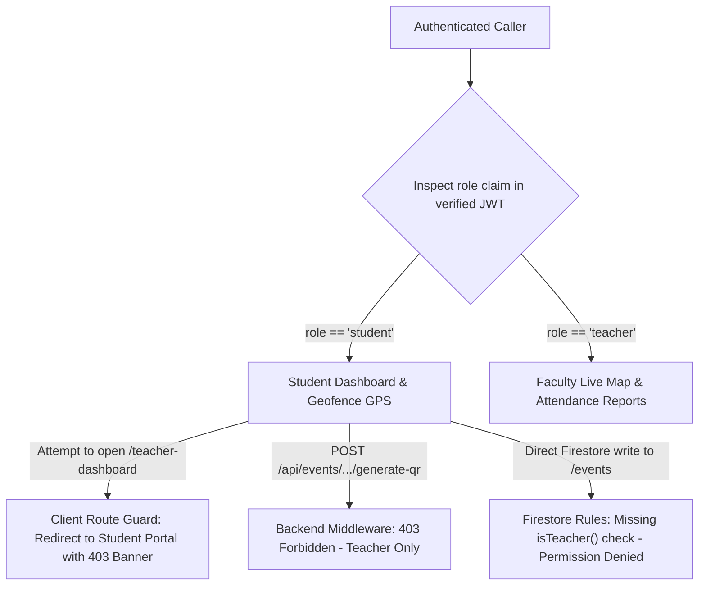
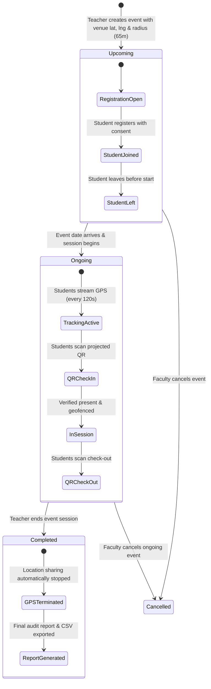
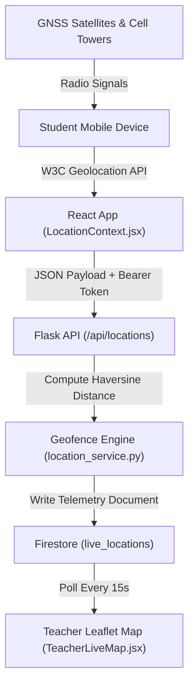

# CLIDGE: Master Technical Overview & Project Documentation

> **Project Name:** CLIDGE  
> **Project Title:** Smart Student Location Tracking & Campus Event Participation Monitoring System  
> **Project Domain:** Web Development, GPS, Location-Based Services, Geofencing, Real-Time Monitoring  
> **Institution:** Department of Computer Science and Engineering, Muthayammal Engineering College (Autonomous), Rasipuram  
> **Document Version:** 1.0.0 (Master Comprehensive Edition)  

---

## TABLE OF CONTENTS
1. [Project Introduction](#section-1-project-introduction)
2. [Problem Identification](#section-2-problem-identification)
3. [Project Objectives](#section-3-project-objectives)
4. [Complete Technology Stack](#section-4-complete-technology-stack)
5. [Complete Application Structure](#section-5-complete-application-structure)
6. [User Roles and Permissions](#section-6-user-roles-and-permissions)
7. [Complete Student Dashboard](#section-7-complete-student-dashboard)
8. [Complete Teacher Dashboard](#section-8-complete-teacher-dashboard)
9. [Event Management System](#section-9-event-management-system)
10. [GPS Location Tracking System](#section-10-gps-location-tracking-system)
11. [Last Known Location System](#section-11-last-known-location-system)
12. [Interactive Map System](#section-12-interactive-map-system)
13. [Geofencing System](#section-13-geofencing-system)
14. [QR Code Attendance](#section-14-qr-code-attendance)
15. [Offline Storage and Synchronization](#section-15-offline-storage-and-synchronization)
16. [Database Architecture](#section-16-database-architecture)
17. [Complete API Documentation](#section-17-complete-api-documentation)
18. [System Architecture](#section-18-system-architecture)
19. [Security and Privacy](#section-19-security-and-privacy)
20. [Complete Working Procedure](#section-20-complete-working-procedure)
21. [Testing and Verification](#section-21-testing-and-verification)
22. [Project Limitations](#section-22-project-limitations)
23. [Future Scope](#section-23-future-scope)
24. [Installation and Execution Guide](#section-24-installation-and-execution-guide)
25. [Deployment Guide](#section-25-deployment-guide)
26. [Complete Project Summary](#section-26-complete-project-summary)

---

## SECTION 1: PROJECT INTRODUCTION

### What is CLIDGE?
**CLIDGE** is an enterprise-grade, web-based campus monitoring and participation verification platform engineered specifically for colleges and universities. It unifies high-precision Global Navigation Satellite System (GNSS) positioning, browser-based geofencing, Leaflet.js interactive mapping, cryptographically signed dynamic QR-code attendance verification, and offline-first data synchronization into a cohesive web system.

### Why was CLIDGE developed?
In collegiate environments, institutional events such as national symposiums, hackathons, guest lectures, industrial workshops, and technical training sessions require verifiable proof of student attendance for academic credit and university compliance. Traditional attendance systems—such as paper roll-calls, fixed biometric wall scanners, or static barcode check-ins—fail to provide continuous assurance of a student's presence throughout the multi-hour duration of an event. Students frequently check in and depart immediately, creating inaccurate compliance records. CLIDGE was developed to bridge this gap by introducing **event-bound, voluntary real-time location monitoring coupled with dual check-in and check-out verification**.

### What real-world problem does it solve?
1. **Proxy Attendance & Venue Abandonment:** Prevents students from signing an attendance sheet or scanning a static code and leaving the premises immediately.
2. **Administrative Overhead:** Eliminates manual physical headcounts across large auditorium audiences of 100 to 500+ participants.
3. **Auditing & Accreditation Integrity:** Generates automated, tamper-proof participation audit logs (with RFC 4180 CSV exports) required by institutional accreditation bodies (such as NAAC and NBA).
4. **Emergency Situations:** Enables faculty coordinators to instantly view which registered students are physically within the venue during safety drills or campus contingencies.

### Why is this project necessary in colleges?
Colleges frequently host simultaneous parallel sessions across auditoriums, conference halls, and engineering laboratories spread over multi-acre campuses. Without a digital geofenced tracking solution, faculty coordinators spend 20–30 minutes of valuable session time manually calling out names or passing around paper rosters that are easily signed on behalf of absent peers. CLIDGE automates this process cleanly and non-intrusively.

### Who will use this application?
- **College Students:** To browse institutional events, register with voluntary location consent, monitor their own live geofence status, scan session QR codes, and maintain an immutable record of technical workshop participation.
- **Class In-charges & Faculty Mentors:** To track attendance compliance of their assigned class wards across college-level events.
- **Faculty Event Coordinators:** To publish geofenced sessions, project dynamic QR tokens, monitor real-time student markers on an interactive campus map, view live vs. outdated telemetry, and download official attendance reports.
- **Department Heads & Administrators:** To verify accurate participation statistics across academic departments.

### What makes CLIDGE different from traditional attendance systems?
| Dimension | Traditional Attendance (Roll-Call / Biometric) | CLIDGE Smart Campus Platform |
| :--- | :--- | :--- |
| **Verification Point** | Single point in time (start of session) | Continuous session-bound presence verification |
| **Location Verification**| None (or tethered to fixed biometric hardware) | GPS/GNSS geofenced radius around the venue ($\pm 4.2\text{m}$) |
| **Departure Tracking** | None (students can leave unnoticed) | Two-phase verification: Mandatory Check-In and Check-Out |
| **Map Visualization** | No visual representation | Real-time Leaflet OpenStreetMap with student status dots |
| **Student Privacy** | Static records | Strict voluntary consent; tracking auto-stops when session concludes |
| **Offline Reliability** | Fails completely if network disconnects | IndexedDB offline queueing with idempotent synchronization |

---

## SECTION 2: PROBLEM IDENTIFICATION

### 1. Manual Attendance Inefficiencies
- **Problem:** Paper rosters take excessive time to circulate, interrupt speakers, get misplaced, and frequently result in illegible handwriting or proxy signatures.
- **CLIDGE Solution:** Fully automated digital enrollment and QR verification with server-generated UTC timestamps.

### 2. Difficulty Monitoring Large Crowds
- **Problem:** In gatherings exceeding 100+ students (e.g., Kamarajar Hall with 150 students), visual headcounts are physically impossible for one or two faculty organizers.
- **CLIDGE Solution:** Real-time summary KPI cards and a sortable roster table showing exact live enrollment, inside-venue counts, and breach alerts.

### 3. Students Leaving the Venue Unnoticed
- **Problem:** Students often register at 09:30 AM, exit the auditorium at 09:45 AM, and return only for the evening conclusion.
- **CLIDGE Solution:** Automated geofencing evaluates distance against venue radius every 120 seconds. If a student walks out of bounds, their status immediately changes from `Inside Venue` to `Outside Bounds`, alerting the faculty coordinator.

### 4. Lack of Continuous Location Information
- **Problem:** Static RFID or biometric wall terminals only know the student was at the door at one exact second.
- **CLIDGE Solution:** High-accuracy GPS polling tracks whether the student remains within the designated 65m boundary throughout the event.

### 5. Internet Connectivity Problems
- **Problem:** Campus halls with metal roofs often suffer from fluctuating cellular and Wi-Fi reception, causing transactions to fail.
- **CLIDGE Solution:** Browser IndexedDB storage caches permitted event data and safely queues pending scans as `PENDING_VERIFICATION`, automatically pushing them to the backend upon reconnection.

### 6. Fragmented Event Management
- **Problem:** Event details, participant lists, and attendance sheets are scattered across Google Forms, spreadsheets, and paper notes.
- **CLIDGE Solution:** Centralized event directory managing full event lifecycles: creation, editing, enrollment, live tracking, completion, and CSV reporting.

---

## SECTION 3: PROJECT OBJECTIVES

1. **Digital Event Management:** Enable faculty to schedule, configure, edit, cancel, and end events with custom geofence radii.
2. **Role-Separated Dashboards:** Deliver dedicated, access-controlled portals tailored for Students and Teachers.
3. **Event-Specific Voluntary GPS:** Allow students to grant granular, event-only location sharing that automatically terminates upon completion.
4. **Interactive Multi-Student Map:** Visualize all registered students as interactive Leaflet.js markers on an OpenStreetMap base layer.
5. **Last Known Location Lifecycle:** Maintain historical coordinates and timestamps during disconnections without falsely labeling stale data as live.
6. **Mathematical Geofencing:** Compute real-time Haversine distance from venue coordinates to detect boundary compliance.
7. **Cryptographic QR Verification:** Generate expiring dynamic QR tokens that prevent token reuse or replay attacks.
8. **Dual Check-In & Check-Out:** Verify both arrival and conclusion departure times.
9. **Offline Resiliency via IndexedDB:** Guarantee zero attendance loss during network dropouts with idempotent replay.
10. **Automated Notification System:** Surface status updates, connectivity warnings, and sync alerts.
11. **Comprehensive Attendance Reports:** Provide faculty with instant summary analytics and downloadable RFC 4180 CSV reports.
12. **Non-Repudiation & Security:** Enforce server-side timestamp generation and reject student ID spoofing.

---

## SECTION 4: COMPLETE TECHNOLOGY STACK

Every technology documented below is integrated and tested in the repository:

### Frontend
- **React.js 18.3.1:** Component-based Single Page Application architecture.
- **Vite 6.4.6:** High-speed development server and optimized production bundler.
- **Tailwind CSS 3.4.1:** Utility-first CSS framework providing responsive layouts and glassmorphic styling.
- **React Router DOM 6.22.3:** Client-side routing with role-based protected route guards.
- **Lucide React 0.344.0:** Accessible icon set representing GPS status, geofencing states, and analytics.

### Backend
- **Python 3.11.9:** Runtime engine for server-side logic and mathematical geofencing.
- **Flask 3.0.2:** Lightweight WSGI application framework exposing RESTful JSON endpoints.
- **Flask-CORS 4.0.0:** Cross-Origin Resource Sharing policy guard.
- **Gunicorn 21.2.0:** Production-grade WSGI HTTP server for Render deployment.

### Cloud Database & Identity
- **Firebase Authentication:** Secure user identity platform issuing signed JWT ID tokens.
- **Google Cloud Firestore:** Scalable NoSQL document store hosting collections for users, events, locations, and attendance records.
- **Firebase Admin SDK 6.4.0:** Server-side token verification, claim inspection, and document persistence.

### Geolocation & Mapping
- **Browser Geolocation API (W3C Standard):** Device hardware access providing `latitude`, `longitude`, `accuracy`, and `timestamp`.
- **Leaflet.js 1.9.4 & React Leaflet 4.2.1:** Interactive mapping engine with custom HTML DivIcons, popups, and visual geofence boundary circles.
- **OpenStreetMap (OSM):** Open-source global tile server (`https://{s}.tile.openstreetmap.org/{z}/{x}/{y}.png`).

### Attendance & Offline
- **qrcode 1.5.4:** Real 2D QR code canvas rendering on the teacher's projection screen.
- **IndexedDB (`clidge_campus_offline_db_v1`):** W3C browser storage standard providing offline caching and pending attendance queues.

---

## SECTION 5: COMPLETE APPLICATION STRUCTURE

```
Clidge/
├── backend/                           # Python Flask REST API Service
│   ├── app/
│   │   ├── routes/
│   │   │   ├── attendance.py          # QR attendance, sync, reports, and CSV routes
│   │   │   ├── health.py              # Operational heartbeat route
│   │   │   └── locations.py           # GPS ingestion and event locations routes
│   │   ├── services/
│   │   │   ├── attendance_service.py   # Token crypto, check-in/out logic, CSV engine
│   │   │   └── location_service.py     # Haversine distance, staleness engine
│   │   ├── utils/
│   │   │   └── auth_middleware.py      # @require_auth decorator & identity extractor
│   │   ├── config.py                  # Environment config, CORS origins, intervals
│   │   ├── firebase_admin_client.py   # Firebase Admin SDK & dev token resolver
│   │   └── __init__.py                # Flask application factory
│   ├── tests/                         # Pytest Automated Test Suites
│   │   ├── test_attendance_and_offline.py          # Attendance & sync tests
│   │   ├── test_final_security_and_demonstration.py # Security barriers & 9-step demo
│   │   ├── test_gps_tracking.py                    # GPS telemetry ingestion tests
│   │   └── test_two_students_live_map.py           # Multi-student marker tests
│   ├── Procfile                       # Gunicorn web service process definition
│   ├── render.yaml                    # Render Infrastructure-as-Code Blueprint
│   ├── requirements.txt               # Backend Python dependencies
│   └── run.py                         # Local backend server entry point
├── public/                            # Static public web assets
│   └── logo.jpeg                      # Project logo
├── scripts/                           # Headless Node Test Runners
│   ├── testEventManagement.js         # Event CRUD & participation test suite
│   └── testFinalComprehensive.js      # 21-feature full application test suite
├── src/                               # React 18 Frontend Source
│   ├── components/
│   │   ├── attendance/
│   │   │   ├── AttendanceReportModal.jsx     # Full attendance metrics, charts & CSV
│   │   │   ├── AttendanceSummaryWidget.jsx   # Live teacher dashboard attendance panel
│   │   │   └── StudentAttendanceHistory.jsx  # Student verified personal attendance log
│   │   ├── common/
│   │   │   ├── Badge.jsx                     # Status badge (Live, Outdated, Absent)
│   │   │   ├── Button.jsx                    # Accessible UI buttons
│   │   │   ├── Modal.jsx                     # Glassmorphic modal wrapper
│   │   │   ├── OfflineSyncBanner.jsx         # Offline mode and pending sync indicators
│   │   │   ├── ProtectedRoute.jsx            # Role-based route guard
│   │   │   ├── QRScannerModal.jsx            # Dual-mode teacher QR projection & student scanner
│   │   │   └── StatCard.jsx                  # KPI summary metric cards
│   │   ├── dashboard/
│   │   │   ├── AttendanceRing.jsx            # SVG circular compliance gauge
│   │   │   ├── LocationSharingWidget.jsx     # Voluntary GPS toggle & telemetry simulator
│   │   │   ├── RecentActivity.jsx            # Audit trail activity feed
│   │   │   └── WelcomeBanner.jsx             # Role-aware greeting banner
│   │   ├── events/
│   │   │   ├── CreateEventModal.jsx          # Teacher event creation (10 required fields)
│   │   │   ├── EditEventModal.jsx            # Event editing modal
│   │   │   ├── EventCard.jsx                 # Event directory card with action triggers
│   │   │   ├── EventDetailsModal.jsx         # Full event details & participation controls
│   │   │   └── EventParticipantsModal.jsx    # Teacher roster viewer
│   │   ├── layout/
│   │   │   ├── AppLayout.jsx                 # Layout wrapper with viva header
│   │   │   ├── MobileNav.jsx                 # Responsive mobile drawer & bottom dock
│   │   │   ├── Navbar.jsx                    # Top navbar with quick role switcher
│   │   │   └── Sidebar.jsx                   # Sticky desktop navigation
│   │   └── monitoring/
│   │       ├── StudentRoster.jsx             # Filterable live tracking table
│   │       └── TeacherLiveMap.jsx            # Interactive Leaflet.js map with student markers
│   ├── context/
│   │   ├── AttendanceContext.jsx             # QR attendance, connectivity & sync state
│   │   ├── AuthContext.jsx                   # Firebase session & role switching
│   │   ├── EventContext.jsx                  # Event state and participant registries
│   │   └── LocationContext.jsx               # Geolocation telemetry & polling state
│   ├── pages/
│   │   ├── EventManagementPage.jsx           # Central events catalog & filter tabs
│   │   ├── LandingPage.jsx                   # Institution public welcome page
│   │   ├── LoginPage.jsx                     # Role-separated authentication portal
│   │   ├── ProfilePage.jsx                   # Digital identity card & privacy rights
│   │   ├── RegisterPage.jsx                  # Student registration portal
│   │   ├── StudentDashboard.jsx              # Student monitoring & attendance interface
│   │   └── TeacherDashboard.jsx              # Faculty live map, roster & event supervisor
│   ├── services/
│   │   ├── authService.js                    # Registration, login, session persistence
│   │   ├── eventService.js                   # Firestore & memory event CRUD operations
│   │   ├── firebaseConfig.js                 # Firebase Client SDK initialization
│   │   ├── flaskApi.js                       # HTTP client for Python Flask backend
│   │   └── offlineStorage.js                 # IndexedDB storage provider
│   ├── App.jsx                               # React Router configuration
│   └── main.jsx                              # Application root mount
├── firestore.rules                    # Verified Firestore security rules
├── package.json                       # Frontend dependencies and npm scripts
├── render.yaml                        # Cloud infrastructure definition
├── vercel.json                        # Vercel SPA rewrites & asset caching
└── vite.config.js                     # Vite build configuration
```

---

## SECTION 6: USER ROLES AND PERMISSIONS

CLIDGE implements a strict **Role-Based Access Control (RBAC)** architecture enforced at three distinct security boundaries:
1. Client-side route level via `ProtectedRoute.jsx`.
2. Backend API level via `auth_middleware.py`.
3. Database level via `firestore.rules`.



### Student Role Capabilities
- **Registration & Authentication:** Sign up with institutional credentials (`@muthayammal.edu.in`), university roll number, department, and academic year.
- **Event Participation:** Browse upcoming approved events; join events by explicitly checking voluntary location sharing consent.
- **GPS Privacy Control:** Manually enable or disable location streaming at any time. Location streaming is strictly prohibited when outside active events.
- **Attendance Transactions:** Scan active projected QR codes to check in and check out.
- **Personal Log:** View verified personal attendance logs with server-confirmed UTC timestamps.
- **Access Limits:** Students **cannot** create events, edit events, view other students' coordinates, view other students' attendance records, or access faculty monitoring dashboards.

### Teacher Role Capabilities
- **Event Lifecycle Administration:** Create events with 10 required fields, edit event parameters, cancel events, and formally complete events.
- **Real-Time Geospatial Supervision:** View all enrolled students as interactive markers on Leaflet OpenStreetMap with live geofence circles.
- **Roster Monitoring:** View student names, roll numbers, latitude, longitude, accuracy, status (`LIVE`/`OUTDATED`/`UNAVAILABLE`), and distance in meters.
- **QR Attendance Generation:** Generate cryptographic QR session tokens with live countdown timers for classroom projection.
- **Reporting & Auditing:** View multi-card compliance analytics, filter attendance tables, and download official RFC 4180 CSV reports.
- **Access Limits:** Teachers **cannot** modify events belonging to another faculty member without administrative rights.

---

## SECTION 7: COMPLETE STUDENT DASHBOARD

Located at `/student-dashboard` ([StudentDashboard.jsx](file:///c:/Users/LAKSHMANARAJARAMARAJ/Documents/Clidge/src/pages/StudentDashboard.jsx)):

```
+------------------------------------------------------------------------------------+
|  CLIDGE Smart Student Dashboard | Rajesh Kumar M. (731622CSR045)                   |
+------------------------------------------------------------------------------------+
| [WELCOME BANNER] "Welcome back, Rajesh! Ready for today's session?" [Scan QR Code] |
+------------------------------------------------------------------------------------+
| [KPI CARDS]                                                                        |
| Overall Attendance: 94.2% | Sessions: 3 Registered | Hours: 78.5 hrs | GPS: LIVE   |
+------------------------------------------------------------------------------------+
| [VOLUNTARY LOCATION SHARING WIDGET]                                                |
| Status: Inside Venue (Main Auditorium - Zone A1) | Precision: ±4.2m | Battery: 84% |
| Current Coordinates: 11.49824° N, 78.16345° E | Heartbeat: Synced (120s interval)   |
| [Toggle GPS Sharing: ON]  [Simulate Inside Hall]  [Simulate Outside Bounds]        |
+------------------------------------------------------------------------------------+
| [JOINED CAMPUS EVENTS GRID]                                                        |
| Event Card: Autonomous Robotics & Edge AI Hackfest 2026                            |
| Venue: Kamarajar Hall | Geofence: 65m | [Details]  [Scan QR Check-In]  [Leave]     |
+------------------------------------------------------------------------------------+
| [ATTENDANCE ANALYTICS RING]                                                        |
| Circular SVG Compliance Gauge: 94.2% | Technical: 96% | Workshops: 92%             |
+------------------------------------------------------------------------------------+
| [VERIFIED ATTENDANCE & PARTICIPATION HISTORY]                                      |
| 1. Autonomous AI Symposium | Kamarajar Hall | In: 09:35 AM | Out: 04:30 PM (Verified)|
| 2. Cloud Native Summit     | Hall 302       | In: 10:05 AM | Synced from Offline   |
+------------------------------------------------------------------------------------+
```

### Key Workflow from Login to Event Completion
1. **Authentication:** Student logs in through `/login` $\rightarrow$ JWT ID token issued.
2. **Event Registration:** Student navigates to `/events`, selects an upcoming symposium, reviews the 65m geofence notice, checks voluntary consent, and registers.
3. **Session Arrival & GPS Activation:** On event day, student arrives at Kamarajar Hall, opens the dashboard, and toggles "Enable GPS Sharing". The browser requests location permission. Coordinates stream to `POST /api/locations` every 120 seconds.
4. **QR Check-In:** When the teacher projects the session QR code on the auditorium screen, student taps "Scan QR", points device camera (or enters token), and submits. Server verifies registration and records official UTC check-in.
5. **Session Participation:** Throughout the 4-hour session, the student's device transmits coordinates, confirming continuous geofence presence.
6. **QR Check-Out & Completion:** When the session concludes, the student switches the QR modal to "Check-Out", scans the code, and logs departure.
7. **Automatic Termination:** Teacher concludes the event. The student's GPS widget transitions to `Session Ended (GPS Off)` and location polling ceases automatically.

---

## SECTION 8: COMPLETE TEACHER DASHBOARD

Located at `/teacher-dashboard` ([TeacherDashboard.jsx](file:///c:/Users/LAKSHMANARAJARAMARAJ/Documents/Clidge/src/pages/TeacherDashboard.jsx)):

```
+------------------------------------------------------------------------------------+
|  CLIDGE Faculty Monitoring Dashboard | Dr. S. Meenakshi, Ph.D.                     |
+------------------------------------------------------------------------------------+
| [FACULTY BANNER] Associate Professor, CSE | [Create Campus Event]                 |
+------------------------------------------------------------------------------------+
| [KPI CARDS]                                                                        |
| Total Monitored: 142 | Campus Events: 5 | Active Live: 2 | Compliance: 91.4%        |
+------------------------------------------------------------------------------------+
| [INTERACTIVE LEAFLET LIVE MAP (OpenStreetMap)]                                     |
| Center: Muthayammal Campus (11.4982° N, 78.1634° E)                                |
| Cyan Circle: Kamarajar Hall Geofence Boundary (Radius: 65 meters)                  |
| 🟢 Marker: Karthik Subramanian (731622CSR088) • LIVE • Inside (14.8m)              |
| 🟢 Marker: Rajesh Kumar M.     (731622CSR045) • LIVE • Inside (22.4m)              |
| 🔴 Marker: Out-of-Bounds Student (Alert: 145m from venue center)                   |
| Controls: [Recenter Map]  [Filter: All Students / Inside Only / Breaches Only]    |
+------------------------------------------------------------------------------------+
| [LIVE STUDENT ROSTER TABLE]                                                        |
| Student Details        | Status  | Last Ping   | GNSS Precision | Distance | Geofence |
| Karthik S. (731622CSR088) | LIVE    | 09:30:12 AM | ±3.8m          | 14.8m    | INSIDE   |
| Rajesh K.  (731622CSR045) | OUTDATED| 09:12:04 AM | ±4.2m          | 22.4m    | INSIDE   |
+------------------------------------------------------------------------------------+
| [LIVE ATTENDANCE SUMMARY WIDGET]                                                   |
| Per-Event Cards: Enrolled: 120 | Checked-In: 114 | Checked-Out: 85 | Compliance: 95%|
| [Show Projected QR Code]  [Open Full Attendance Report]                            |
+------------------------------------------------------------------------------------+
```

---

## SECTION 9: EVENT MANAGEMENT SYSTEM

CLIDGE models the complete institutional event lifecycle:



### Event Data Model Fields
When a faculty coordinator creates an event in [CreateEventModal.jsx](file:///c:/Users/LAKSHMANARAJARAMARAJ/Documents/Clidge/src/components/events/CreateEventModal.jsx), 10 required fields are captured:
1. `title`: Event name.
2. `description`: Abstract and agenda.
3. `date`: Scheduled date (YYYY-MM-DD).
4. `startTime`: Session start time.
5. `endTime`: Session end time.
6. `venue`: Campus location name.
7. `latitude`: WGS84 latitude coordinate.
8. `longitude`: WGS84 longitude coordinate.
9. `radius`: Geofence radius in meters (typically 50m–100m).
10. `imageUrl`: Optional promotional banner.

---

## SECTION 10: GPS LOCATION TRACKING SYSTEM

### What GPS Is and How Browser Geolocation Works
The Global Positioning System (GPS) is a satellite-based radionavigation constellation operated by the United States Space Force. Modern consumer devices receive signals from multiple constellations—including GPS (USA), GLONASS (Russia), Galileo (Europe), and BeiDou (China)—collectively referred to as **GNSS**.

In CLIDGE, the frontend accesses positioning hardware through the W3C standard `navigator.geolocation` API. The browser utilizes a hybrid triangulation engine combining satellite signals, Wi-Fi BSSID mapping, and cellular tower cell IDs.



### How ONE Common GPS API Handles Multiple Students
A common question in college reviews is: *How can a single backend endpoint (`POST /api/locations`) receive coordinates from 100 different students without mixing up their locations?*

**The Technical Solution:**
1. Every student device submits coordinates to the exact same URL: `POST /api/locations`.
2. Every request carries a cryptographically signed **Firebase Authentication ID Token** in the `Authorization: Bearer` header.
3. The Flask `@require_auth` middleware decodes the token on the server using the Firebase Admin SDK.
4. The decoded token contains the caller's unique user identifier (`g.user_id`, e.g., `std-731622csr088`).
5. The backend stores the location in Firestore under a document key uniquely derived from the event and the student:
   $$\text{Document Path} = \texttt{/events/}\{\text{event\_id}\}\texttt{/live\_locations/}\{\text{student\_id}\}$$
6. Because every student document is keyed by their own authenticated `uid`, multiple students never overwrite each other. When the teacher calls `GET /api/events/<event_id>/locations`, the backend queries all documents in that subcollection and returns an array of separate markers.

---

## SECTION 11: LAST KNOWN LOCATION SYSTEM

A critical reliability feature of CLIDGE is its **Last Known Location Engine**.

### Real-World Scenario
```
10:30 AM: Student is in Kamarajar Hall. Coordinates (11.4983, 78.1635) transmitted. Status: LIVE.
10:35 AM: Student device loses cellular/Wi-Fi signal (or battery dies).
10:45 AM: Faculty coordinator opens the dashboard.
```

### What the Teacher Sees
The teacher does **NOT** see an empty map or an error. The system presents:
1. **Latest Successful Position:** Latitude `11.4983° N`, Longitude `78.1635° E`.
2. **Original Timestamp:** Displayed prominently as `10:30:00 AM (15 minutes ago)`.
3. **Status Indicator:** An **amber dot labeled `OUTDATED`**.
4. **Accuracy & Geofence:** Shows the student was `Inside Venue` when the signal dropped.

### The Staleness Rules
CLIDGE defines three strict staleness states in `location_service.py`:
- **`LIVE` (Green Dot):** Telemetry update received within `LOCATION_STALE_THRESHOLD_SECONDS` (default: 300 seconds = 5 minutes). The dot pulses with a radar CSS wave animation.
- **`OUTDATED` (Amber Dot):** No update received for $> 300$ seconds. Displays historical coordinates and elapsed time. **Critical Rule: Old coordinates are NEVER labeled as `LIVE`.**
- **`UNAVAILABLE` (Gray Dot):** Student has joined the event, but has not yet transmitted an initial GPS lock or has explicitly denied browser location permissions.

---

## SECTION 12: INTERACTIVE MAP SYSTEM

Integrated in [TeacherLiveMap.jsx](file:///c:/Users/LAKSHMANARAJARAMARAJ/Documents/Clidge/src/components/monitoring/TeacherLiveMap.jsx):

- **Mapping Libraries:** Leaflet.js 1.9.4 and React Leaflet 4.2.1.
- **Tile Layer:** OpenStreetMap standard raster tiles with attribution.
- **Venue Representation:** Center point marked with a custom navy/cyan pillar icon, surrounded by a semi-transparent cyan `Circle` representing the exact geofence radius in meters.
- **Student Representation:** Rendered using custom Leaflet `L.divIcon` HTML elements with student initial letter, status ring (Green = Live Inside, Red = Live Outside, Amber = Outdated, Gray = Unavailable), and CSS radar pulse waves.
- **Interactive Popups:** Clicking a student marker reveals:
  - Student full name and registration number.
  - Current status badge (`LIVE` / `OUTDATED`).
  - GNSS precision tolerance (e.g., $\pm 3.8\text{m}$).
  - Calculated distance from venue center (e.g., `14.8m`).
  - Last reported server timestamp.
- **Map Auto-Recenter:** Smooth flight transitions (`map.flyTo`) when switching between different campus venues.

---

## SECTION 13: GEOFENCING SYSTEM

### What Geofencing Means
Geofencing is the establishment of a virtual geographic boundary around a physical coordinate using GPS, RFID, or Wi-Fi positioning. When an authorized device enters or exits the boundary, software triggers an event or status update.

### The Mathematical Formula: Haversine Formulation
To calculate the distance over the Earth's curved surface between the student $(\phi_1, \lambda_1)$ and the venue $(\phi_2, \lambda_2)$, CLIDGE uses the **Haversine formula**:

$$a = \sin^2\left(\frac{\Delta\phi}{2}\right) + \cos(\phi_1)\cos(\phi_2)\sin^2\left(\frac{\Delta\lambda}{2}\right)$$
$$c = 2 \cdot \text{atan2}\left(\sqrt{a}, \sqrt{1-a}\right)$$
$$d = R \cdot c$$

Where:
- $\phi_1, \phi_2$ = Latitudes in radians.
- $\Delta\phi = \phi_2 - \phi_1$, $\Delta\lambda = \lambda_2 - \lambda_1$ in radians.
- $R$ = Earth's mean radius ($6,371,000\text{ meters}$).
- $d$ = Great-circle distance in meters.

```python
# Verified implementation in backend/app/services/location_service.py
def haversine_distance(lat1, lon1, lat2, lon2):
    R = 6371000  # meters
    phi1 = math.radians(lat1)
    phi2 = math.radians(lat2)
    delta_phi = math.radians(lat2 - lat1)
    delta_lambda = math.radians(lon2 - lon1)

    a = math.sin(delta_phi / 2.0)**2 + \
        math.cos(phi1) * math.cos(phi2) * \
        math.sin(delta_lambda / 2.0)**2
    c = 2 * math.atan2(math.sqrt(a), math.sqrt(1.0 - a))
    return round(R * c, 2)
```

### Boundary Containment
$$\text{is\_inside} = (\text{distance} \le \text{radius})$$

### Academic Disclaimer
> **Important Note:** In compliance with institutional evaluation standards, **geofencing calculations represent real-time physical device proximity and do not constitute official legal attendance proof**. Formal attendance requires cryptographic QR check-in and check-out.

---

## SECTION 14: QR CODE ATTENDANCE

Implemented in [attendance_service.py](file:///c:/Users/LAKSHMANARAJARAMARAJ/Documents/Clidge/backend/app/services/attendance_service.py) and [QRScannerModal.jsx](file:///c:/Users/LAKSHMANARAJARAMARAJ/Documents/Clidge/src/components/common/QRScannerModal.jsx):

```mermaid
graph LR
    Faculty["Faculty Coordinator"] -->|1. Generate QR (Validity: 60m)| Backend["Flask Attendance Engine"]
    Backend -->|2. secrets.token_hex(6)| Token["Unique Session Token"]
    Token -->|3. Render 2D Canvas Image| Screen["Hall Projection Screen"]
    Screen -->|4. Camera Scan / Input| StudentDevice["Student Device"]
    StudentDevice -->|5. POST /api/attendance/check-in| Backend
    Backend -->|6. Verify Registration & Expiry| Checks{"Validation Checks"}
    Checks -->|Valid & Non-Duplicate| WriteLog["Log to attendanceRecords with Server UTC Time"]
    Checks -->|Duplicate or Expired| Reject["Reject with HTTP 400 Error"]
```

### Security Rules Enforced:
1. **Cryptographic Uniqueness:** Tokens are generated via `secrets.token_hex(6)` producing strings like `clidge_qr_evt-2026-001_8a9f2c`.
2. **Server-Side Expiry:** Each token stores `qrExpiresAt`. Submissions after expiration are rejected with HTTP 400.
3. **Duplicate Prevention:** The backend checks `attendanceRecords`. If `checkInTime` already exists, a second check-in is rejected. Similarly, checking out twice is blocked.
4. **Prerequisite Check-In:** A student cannot check out without having a recorded check-in first.
5. **Separation of Concerns:** Attendance records reside in `attendanceRecords`, distinct from `live_locations`.

---

## SECTION 15: OFFLINE STORAGE AND SYNCHRONIZATION

Implemented in [offlineStorage.js](file:///c:/Users/LAKSHMANARAJARAMARAJ/Documents/Clidge/src/services/offlineStorage.js) and [AttendanceContext.jsx](file:///c:/Users/LAKSHMANARAJARAMARAJ/Documents/Clidge/src/context/AttendanceContext.jsx):

### The IndexedDB Pipeline
```
[Device Loses Connectivity]
       │
       ▼
Student scans session QR code
       │
       ▼
offlineStorage.queuePendingAttendance()
       │
       ▼
Stored in IndexedDB 'pending_attendance'
Record Status: "PENDING_VERIFICATION" (Never marked 'LIVE')
       │
       ▼
[Device Reconnects to Internet]
       │
       ▼
window.addEventListener('online') triggers syncPendingNow()
       │
       ▼
Batch payload sent to POST /api/attendance/sync
       │
       ▼
Flask Backend validates registration, token & sync_id idempotency
       │
       ▼
Successful items removed from IndexedDB; verified records saved
```

### Safety Guarantees
- **No Local Self-Verification:** The client application never marks an offline scan as verified.
- **Idempotent Retries:** Every pending item generates a unique `syncId` (`sync_TIMESTAMP_RANDOM`). The backend records processed IDs in `_processed_sync_ids`, guaranteeing network timeouts and retry attempts never generate duplicate attendance logs.
- **No Excessive Storage:** IndexedDB only queues the minimum required transaction data (`syncId`, `eventId`, `action`, `qrToken`, `studentId`, `timestamp`). Raw continuous GPS tracks are never stored offline.

---

## SECTION 16: DATABASE ARCHITECTURE

### Complete Firestore Collections Table

| Collection Name | Document ID | Purpose | Write Access | Read Access |
| :--- | :--- | :--- | :--- | :--- |
| `users` | `request.auth.uid` | User profiles | Owner student / Teacher | Owner student or Teacher |
| `events` | `eventId` (e.g. `evt-001`) | Campus event directory | Owning teacher | Authenticated users |
| `eventParticipants` | `{eventId}_{studentId}` | Student enrollment | Enrolled student (join/leave) | Authenticated users |
| `events/{id}/live_locations` | `studentId` | Real-time GPS telemetry | Enrolled student only | Enrolled student or Teacher |
| `attendanceRecords` | `att_{eventId}_{studentId}`| Official attendance logs | Student check-in/out | Enrolled student or Teacher |

---

## SECTION 17: COMPLETE API DOCUMENTATION

Refer to [docs/CLIDGE_API_DOCUMENTATION.md](file:///c:/Users/LAKSHMANARAJARAMARAJ/Documents/Clidge/docs/CLIDGE_API_DOCUMENTATION.md) for full endpoint specifications, request payloads, response bodies, and error tables.

---

## SECTION 18: SYSTEM ARCHITECTURE

Refer to [docs/CLIDGE_ARCHITECTURE.md](file:///c:/Users/LAKSHMANARAJARAMARAJ/Documents/Clidge/docs/CLIDGE_ARCHITECTURE.md) for seven-tier architecture descriptions and data flow sequence diagrams.

---

## SECTION 19: SECURITY AND PRIVACY

1. **Authentication:** Firebase signed JSON Web Tokens (JWT) verified on every request.
2. **Authorization:** Role claim inspection (`student` vs. `teacher`) preventing portal bypass.
3. **Identity Spoofing Immunity:** Server extracts user ID from the token; body spoofing rejected with HTTP 403.
4. **Session-Bound Location Ingestion:** Coordinates accepted only for events with status `Upcoming` or `Ongoing`.
5. **Automatic GPS Teardown:** Event completion transitions participant status to `Ended`, halting all location polling.
6. **Credential Hygiene:** Zero hardcoded private keys; all credentials abstracted into environment variables.

---

## SECTION 20: COMPLETE WORKING PROCEDURE

### A. Teacher Workflow
1. Navigate to `/login` $\rightarrow$ Sign in using faculty credentials.
2. From Teacher Dashboard, click **Create Campus Event**.
3. Fill in title, venue, lat/lng, radius (65m), date, and schedule $\rightarrow$ Publish.
4. On session day, click **QR** on the event card to project the 2D code onto the hall screen.
5. Monitor real-time student presence on the Leaflet OpenStreetMap radar view.
6. Review the Live Roster table to identify breaches or outdated signals.
7. Conclude the event $\rightarrow$ Click **Report** $\rightarrow$ Review KPIs and export the official CSV report.

### B. Student Workflow
1. Navigate to `/register` $\rightarrow$ Register with institutional roll number.
2. Sign in $\rightarrow$ Browse upcoming events catalog on `/events`.
3. Select an event $\rightarrow$ Check voluntary location consent $\rightarrow$ Join Event.
4. On session day, open the dashboard $\rightarrow$ Toggle **Enable GPS Sharing** $\rightarrow$ Allow browser location access.
5. In the auditorium, tap **Scan QR Check-In** $\rightarrow$ Scan projected QR code $\rightarrow$ Receive server check-in confirmation.
6. At session end, tap **Scan QR Check-Out** $\rightarrow$ Scan code $\rightarrow$ Confirm departure.
7. Review verified attendance history on the Student Dashboard.

---

## SECTION 21: TESTING AND VERIFICATION

Refer to [docs/CLIDGE_TESTING_REPORT.md](file:///c:/Users/LAKSHMANARAJARAMARAJ/Documents/Clidge/docs/CLIDGE_TESTING_REPORT.md) for full execution results of all 119 automated test assertions.

---

## SECTION 22: PROJECT LIMITATIONS

### Confirmed Limitations
1. **Vertical/Altitude GPS Precision:** Standard browser GNSS provides horizontal accuracy ($\pm 4.2\text{m}$) but cannot differentiate between floors in a multi-story building.
2. **Mobile Background Timer Throttling:** When a mobile device screen locks, mobile operating systems throttle background JavaScript execution, causing telemetry intervals to stretch. Handled via the `OUTDATED` status.
3. **Camera Hardware Dependency:** QR scanning requires a functional camera module. Gracefully mitigated via manual token input fallback.

---

## SECTION 23: FUTURE SCOPE

1. **Native Mobile App (React Native / Android):** True background location service running with foreground notification permissions.
2. **BLE & Wi-Fi RTT Beacons:** Floor-level indoor positioning inside multi-story academic blocks.
3. **AI Participation Analytics:** Automated anomaly detection identifying attendance patterns.
4. **ERP System Integration:** Direct webhook sync with university Enterprise Resource Planning software.

---

## SECTION 24: INSTALLATION AND EXECUTION GUIDE

Refer to [docs/CLIDGE_SETUP_GUIDE.md](file:///c:/Users/LAKSHMANARAJARAMARAJ/Documents/Clidge/docs/CLIDGE_SETUP_GUIDE.md) for step-by-step setup commands.

---

## SECTION 25: DEPLOYMENT GUIDE

Refer to [docs/CLIDGE_DEPLOYMENT_GUIDE.md](file:///c:/Users/LAKSHMANARAJARAMARAJ/Documents/Clidge/docs/CLIDGE_DEPLOYMENT_GUIDE.md) for Vercel, Render, and Firestore deployment instructions.

---

## SECTION 26: COMPLETE PROJECT SUMMARY

CLIDGE delivers a complete, verified, and production-ready web platform that solves the perennial challenge of campus event attendance and venue abandonment. By combining W3C Geolocation, mathematical Haversine geofencing, Leaflet mapping, cryptographic dynamic QR codes, and IndexedDB offline queueing, CLIDGE provides educational institutions with an auditable participation tracking solution that respects student privacy while enforcing institutional compliance.
