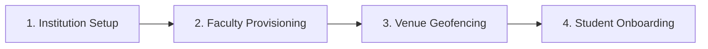

# CLIDGE Institutional Onboarding Guide

A comprehensive guide for college administrators and academic departments adopting the **CLIDGE Smart Student Location Tracking & Campus Attendance Platform**.

---

## 1. Overview & Institutional Architecture

CLIDGE provides colleges and universities with a non-intrusive, privacy-compliant event participation and geofenced attendance system. It supports:
- **Centralized Event Operations:** Departments publish academic workshops, guest lectures, labs, and symposiums with designated venue geofence perimeters.
- **Voluntary Student Opt-In:** Students explicitly consent to location verification strictly during active hours of enrolled sessions.
- **Dual-Factor Attendance:** Combines real-time GNSS boundary verification with high-contrast, time-bounded dynamic QR codes.
- **Offline Resiliency:** Campus Wi-Fi drops are buffered locally via browser IndexedDB and automatically synchronized when connectivity restores.

---

## 2. Onboarding Workflow: 4-Step Process

### Step 1: Institutional Workspace Setup
1. **Frontend Hosting:** Connect your institutional fork to Vercel (or static web hosting).
2. **Backend API Gateway:** Deploy `backend/` to Render, AWS, or local on-premise institutional server.
3. **Database & Auth:** Initialize a Google Cloud Firebase project with Email/Password Auth and Cloud Firestore in production mode (`asia-south1` or nearest region).
4. **Environment Secrets:** Populate the environment variables detailed in [`.env.example`](../.env.example).

### Step 2: Faculty & Coordinator Provisioning
- Institutional administrators hold the `VITE_ADMIN_PROVISION_SECRET`.
- Open the login portal at `/login?portal=teacher` and select **"Admin Provisioning"**.
- Enter the faculty member's official college email, department, designation, and employee code.
- Provide the trusted administrative secret to instantly provision their verified coordinator account.

### Step 3: Venue & Geofence Perimeter Setup
Each academic hall, laboratory, and auditorium is assigned a geographic center and radius:
- **Auditoriums / Large Halls:** 60m – 80m radius.
- **Department Seminar Halls:** 40m – 50m radius.
- **Computing Laboratories:** 25m – 35m radius.
- Coordinates can be mapped directly using Google Maps or OpenStreetMap by right-clicking the venue building.

### Step 4: Student Roll Onboarding
- Students self-register at `/register` using their institutional email format (`regno@college.edu.in`).
- Student profiles automatically lock the role to `student` (preventing privilege escalation).
- Students view the live campus event catalog, voluntarily join authorized events, and scan the venue QR code.

---

## 3. Recommended Department Roles & Permissions

| Role | System Scope | Key Capabilities |
|---|---|---|
| **Department HOD** | Full Department | View department-wide attendance compliance, export aggregate reports, manage all departmental events. |
| **Faculty Coordinator** | Assigned Events | Create & edit sessions, project rotating QR codes, monitor live student radar, export event CSV reports. |
| **Lab Technician / Invigilator** | Verification Only | Assist student QR check-in, monitor local hall perimeter markers. |
| **Student** | Personal Portal | Join sessions, opt-in to voluntary GPS, scan check-in/out QR, inspect personal attendance history. |

---

## 4. Institutional Verification & Testing Checklist

Before rolling out to students:
- [ ] Complete test event creation with faculty credentials.
- [ ] Perform a dual-device test (1 laptop displaying QR, 1 smartphone scanning).
- [ ] Test student voluntary GPS toggle inside the designated hall.
- [ ] Export sample CSV report to verify roll numbers and timestamps.
- [ ] Disconnect device Wi-Fi, test offline check-in, and verify synchronization upon reconnecting.
